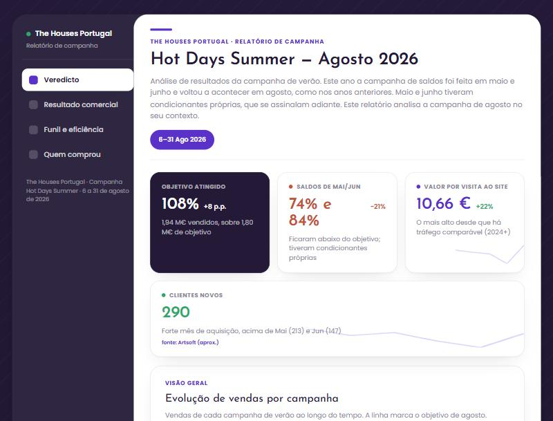
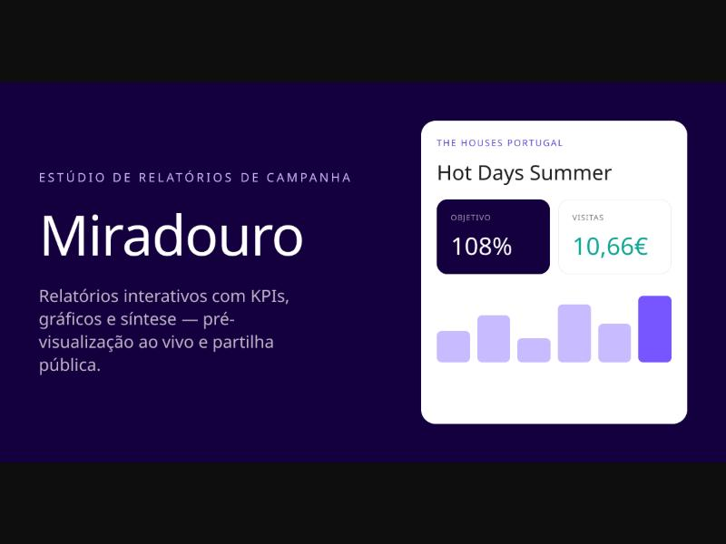

<div align="center">

# Miradouro

**Estúdio para criar relatórios de campanha interativos — e partilhá-los.**

KPIs, gráficos, tabelas e síntese a partir de um esquema simples, com pré-visualização ao
vivo, gravação automática, temas, seis idiomas e partilha por link público.

[**▶ Ver demo**](https://miradouro.vercel.app) · Next.js · Supabase · TypeScript


</div>

---

## O que é

O Miradouro é um **estúdio de relatórios de campanha**. O núcleo é um *motor* que renderiza
um relatório completo — moldura, abas, KPIs, gráficos, tabelas, funil, notas e síntese — a
partir de um único **JSON** (um esquema de blocos). Em cima do motor há uma app com contas,
dashboard, um **editor** (formulário ou JSON) com pré-visualização ao vivo e autosave, e
**partilha pública** por `/r/[id]`.

O mesmo motor que vês no editor gera o relatório público **e** o HTML autónomo que
descarregas para apresentar offline.

<table>
  <tr>
    <td></td>
    <td></td>
  </tr>
</table>

## Funcionalidades

- **Motor guiado por dados** — 15 tipos de bloco (kpis, card, row, barChart, areaChart,
  table, note, banner, synthesis, callout, funnel, progress, heading, text, spacer) e 4
  paletas de tema, todos a partir de JSON.
- **Editor por formulário ou JSON** — cabeçalho, KPIs, tabelas, notas e síntese por
  formulário; JSON para o controlo total. Botão **Instruções p/ Claude** para gerar o JSON.
- **Pré-visualização ao vivo + autosave** — vês o relatório a montar-se enquanto escreves;
  cada alteração grava sozinha (debounce).
- **Partilha pública** — um toggle publica em `/r/[id]`, protegido por RLS.
- **Download de HTML autónomo** — um ficheiro self-contained (engine + dados embutidos,
  libs por CDN com SRI) para apresentar sem servidor.
- **Comparar** — dois relatórios lado a lado ou empilhados.
- **Tema claro/escuro** e **seis idiomas** (PT-PT, PT-BR, EN, ES, FR, 中文), com a escolha
  guardada no dispositivo.
- **Acabamentos** — landing pública, skeletons de carregamento, estados vazios, 404 e erro
  próprios, metadata/OpenGraph, e respeito por `prefers-reduced-motion`.

## Stack

| Camada | Tecnologia |
|---|---|
| Framework | **Next.js 15** (App Router, TypeScript) |
| Backend | **Supabase** — Auth (email/password) + Postgres + **Row-Level Security** |
| Gráficos | **Recharts** |
| Tipografia | Josefin Sans (títulos) + Poppins (corpo), via `next/font` |
| Deploy | **Vercel** |

### Estrutura

```
src/
  report/engine.tsx            motor (blocos + temas + moldura)
  report/engine.standalone.txt espelho do motor para o HTML exportado
  report/defaultReport.ts      relatório-semente
  lib/standalone.ts            geração do HTML autónomo
  lib/i18n.ts · lib/prefs.tsx  i18n (6 idiomas) + tema/idioma persistentes
  lib/supabase/*               clientes browser/server + guarda de env
  app/                         landing (/), login, dashboard, report/[id],
                               compare, r/[id], loading/error/not-found, OG
supabase/migrations/0001_init.sql   tabela reports + trigger + RLS + grants
```

## Começar

Pré-requisitos: Node 18+ e um projeto Supabase.

```bash
npm install
```

1. **Supabase** — cria um projeto, copia de *Project Settings → API* o **Project URL** e a
   chave **anon / public**.
2. **Migração** — em *SQL Editor*, corre o conteúdo de
   [`supabase/migrations/0001_init.sql`](supabase/migrations/0001_init.sql) (cria a tabela
   `reports`, o trigger de `updated_at`, o RLS e os grants).
3. **Env** — cria `.env.local`:

   ```bash
   NEXT_PUBLIC_SUPABASE_URL=https://<teu-projeto>.supabase.co
   NEXT_PUBLIC_SUPABASE_ANON_KEY=<chave-anon-publishable>
   ```

4. **Correr**

   ```bash
   npm run dev     # http://localhost:3000
   ```

> A chave `anon`/publishable é pública por design — a proteção dos dados é o **RLS**, não o
> segredo da chave. Nunca ponhas a `service_role` no cliente.

## Deploy (Vercel)

1. Importa o repositório no Vercel.
2. Em *Settings → Environment Variables*, define `NEXT_PUBLIC_SUPABASE_URL` e
   `NEXT_PUBLIC_SUPABASE_ANON_KEY` (tipo **Config**, não *Sensitive* — têm prefixo público).
3. Como são `NEXT_PUBLIC_*` (embutidas no build), faz **Redeploy** após as definir.
4. Opcional: define `NEXT_PUBLIC_SITE_URL` com o domínio final para os links OpenGraph.

## Esquema do relatório

O formato do JSON (blocos, formatos de número, cores e tokens de tema) está descrito no
próprio editor (botão **Instruções p/ Claude**) e nos tipos em `src/types/report.ts`.

---

<div align="center">
<sub>Construído como peça de portfólio — foco em motor reutilizável, RLS correto, i18n
completo e acabamento de produto.</sub>
</div>
